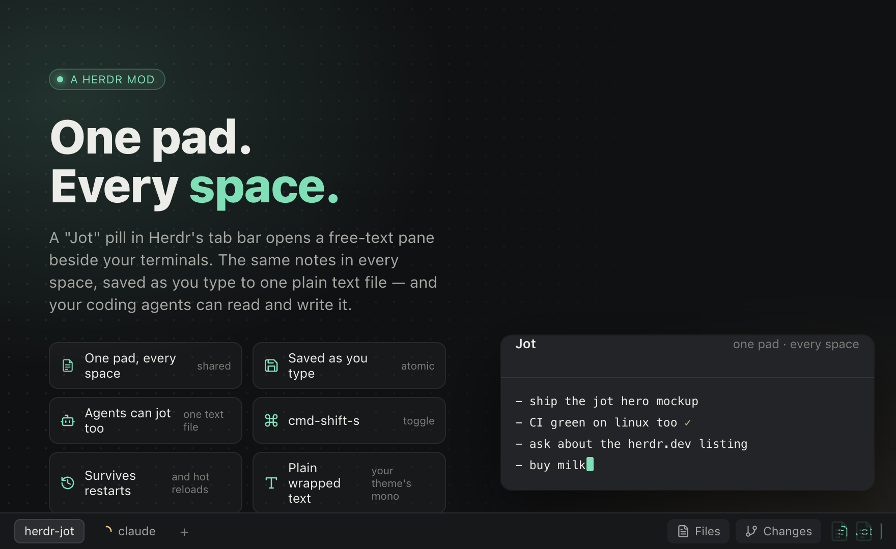
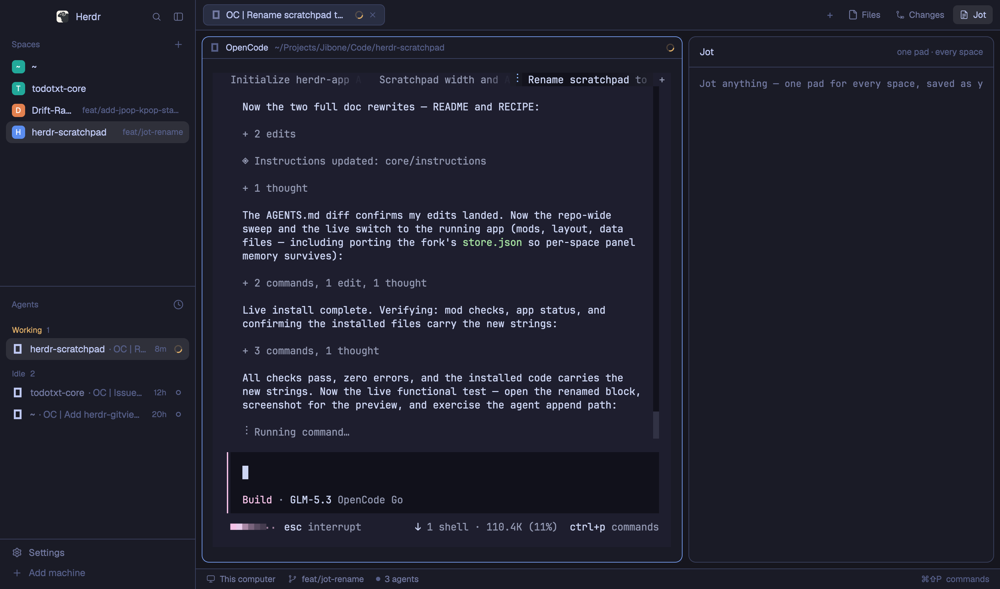

<p align="center">
  
</p>

<h1 align="center">herdr-jot</h1>

<p align="center"><strong>One Jot pad for the whole Herdr app: the same notes in every space, saved as you type to one plain text file — a file your coding agents can read and write too.</strong></p>

<p align="center">
  <a href="LICENSE"></a>
  <a href="https://herdr.dev/mods"></a>
  
  <a href="https://github.com/jibone/herdr-jot/actions/workflows/macos.yml"></a>
  <a href="https://github.com/jibone/herdr-jot/actions/workflows/linux.yml"></a>
  
</p>

<p align="center">
  <a href="#what-it-looks-like">What it looks like</a> · <a href="#what-you-get">What you get</a> · <a href="#install">Install</a> · <a href="#develop">Develop</a> · <a href="#notes--trade-offs">Notes</a> · <a href="RECIPE.md">Recipe</a>
</p>

<br>

A "Jot" pill sits in the tab bar next to Files and Changes. Click it
(or press `cmd-shift-s`) and a free-text pane opens on the right side of the
window. It's one pad for the whole app: the same text in every space, saved
as you type to a single text file, still there after a restart or a hot
reload.

## What it looks like



The real window running the pad — the mockup above only sets the scene.

## What you get

- **One pad, every space** — the text lives in
  `~/.config/herdr-app/data/jot/jot.txt`, so every space sees
  the same contents.
- **Saved as you type** — every change is written atomically (latest wins);
  there's no save button and nothing to forget.
- **Coding agents can read and write it** — the pad watches its own file:
  an agent that appends a note shows up in the open pad within a moment
  (while the pane is closed too — it's there on the next open). While
  you're typing, your text wins. Tell your agent the path (opencode:
  a line in `~/.config/opencode/AGENTS.md`; other agents: their
  equivalent) and "jot it down" just works, from any project.
- **Native feel** — the pill matches the Files/Changes buttons, the pane is
  a card like the terminal panes, and each space remembers whether it had
  the pad open, exactly like Files and Changes.
- **A keyboard way in** — `cmd-shift-s` toggles it while the layout shows.
- **Plain wrapped text, in mono** — one comfortable textarea in the
  terminals' font (JetBrains Mono unless settings.json names another), in
  your theme, light or dark.

## Install

Requires the [Herdr app](https://herdr.dev) on macOS or Linux, and a layout
derived from Herdr's shipped `main`.

**The agent way** — one line, the same pattern as the mods listed on
[herdr.dev/mods](https://herdr.dev/gallery/?type=mods). Tell your coding
agent:

```
Read ~/.config/herdr-app/AGENTS.md, then add this mod: https://github.com/jibone/herdr-jot
```

It reads `RECIPE.md` and every file first, tells you what the pad touches
(one text file, `~/.config/herdr-app/data/jot/jot.txt` — no network,
nothing executed), then copies the two mods into
`~/.config/herdr-app/mods/`, grafts the two layout edits onto your own
main-derived layout, merges the key into `~/.config/herdr-app/keys.json`
(renaming the `layout:main-copy` section to your layout's name), runs
`herdr-app check` on both mods and tries the pill in the app.

**By hand instead:**

```sh
# the two mods (their test folders are dev-only and stay out)
rsync -a --exclude test --exclude gpui-kit.d.ts --exclude herdr.d.ts --exclude jsconfig.json \
  mods/ ~/.config/herdr-app/mods/
```

No layout file ships with the mod: herdr.dev's mod listing takes packages
without a `layouts/` folder, and my own daily layout wouldn't fit yours
anyway. Graft two edits onto any main-derived layout:

- point the `tabs` block at `"tabs-jot"`
- add the hidden right-side block to `work-body`, after `panel`:

```json
{ "id": "jot", "type": "block", "content": { "mod": "jot" },
  "size": { "px": 420 }, "min": 260, "max": 900, "hidden": true }
```

Then merge this repo's `keys.json` into `~/.config/herdr-app/keys.json`
(rename the `layout:main-copy` section to your layout's name, and check
`cmd-shift-s` isn't already bound first), and verify:

```sh
herdr-app check ~/.config/herdr-app/mods/jot
herdr-app check ~/.config/herdr-app/mods/tabs-jot
```

## Develop

```sh
rsync -a --delete --exclude test --exclude gpui-kit.d.ts --exclude herdr.d.ts --exclude jsconfig.json \
  mods/jot/ ~/.config/herdr-app/mods/jot/
rsync -a --delete --exclude test --exclude gpui-kit.d.ts --exclude herdr.d.ts --exclude jsconfig.json \
  mods/tabs-jot/ ~/.config/herdr-app/mods/tabs-jot/
npm ci && npm test
herdr-app check ~/.config/herdr-app/mods/jot
herdr-app check ~/.config/herdr-app/mods/tabs-jot
```

Copy the mods, don't symlink them: Herdr won't load icons through a link
that leaves its home, so the Jot pill would be blank. Saving into the
installed copy hot-reloads it, so the `rsync` above is enough.

`npm test` runs the jot mod's tests — the real `main.js` over host
stand-ins, `node --test`, no dependencies, Node 24 or newer — then the
quality gate in `test/quality/`: eslint (size and complexity limits, the
one class per mod, no eslint-disable escapes), jscpd (no copied code), and
the probes that keep both honest. The tabs-jot fork is held to base and
style rules only: it's Herdr's own code, frozen at the version it was
cloned from, and never edited to satisfy a rule. CI runs the same
`npm test` on Linux and macOS (`.github/workflows/`) for every pull
request and push to `master`; a pull request merges only when both pass.

[RECIPE.md](RECIPE.md) is the brief to build the plugin from scratch.

## Repo layout

| Path | What |
|---|---|
| `mods/jot/` | the pad: `main.js`, `mod.json`, `icon.svg`, and `test/` (not installed) |
| `mods/tabs-jot/` | fork of Herdr's shipped tab bar: the Jot pill + per-space open memory |
| `keys.json` | the `cmd-shift-s` binding to merge by hand |
| `test/quality/`, `tools/quality/` | the quality gate `npm test` runs after the mod's tests |
| `assets/` | the hero image, its source (`assets/src/hero.html`), and the real screenshot it embeds |
| `.github/workflows/` | CI: `npm test` on Linux and macOS |
| `RECIPE.md` | the brief to rebuild the whole plugin from scratch |
| `AGENTS.md` | instructions for coding agents working in this repo |

## Notes & trade-offs

- Herdr's own layouts and mods are read-only; putting a pill in that tab
  bar means forking it. The fork (`tabs-jot`) is frozen at the
  version it was cloned from — if Herdr ships tab-bar changes, re-clone and
  re-apply (the fork's header comment lists its change set).
- Switching to the fork resets Files/Changes per-space panel memory once.
- The pad saves on every change; the text file is the source of truth
  (Herdr's `readTextFile` caps it at 1 MiB).
- Agents don't find the pad's path by themselves: put it in your coding
  agent's global instructions (opencode: `~/.config/opencode/AGENTS.md`;
  others: their equivalent), or the convention only reaches agents working
  inside this repo.
- Shared the way the gallery documents — a public repo with `RECIPE.md`,
  `preview.png`, the `herdr-mod` topic and no `layouts/` folder (its mod
  listing requires that) — so it lists at
  [herdr.dev/mods](https://herdr.dev/gallery/?type=mods) on the gallery's
  next crawl.

## Credits

`mods/tabs-jot/` is a fork of Herdr's shipped `tabs` mod, kept verbatim
except for its one change set (the fork's header comment lists it).
`assets/hero.png` and `preview.png` render from `assets/src/hero.html`
(headless Chrome, 880×540 at 2× and 1.591×): the mockup's right side is
the real app, committed as `assets/screenshot.png`.

## License

[MIT](LICENSE)

For agents and contributors: read `AGENTS.md` first — it points at
`~/.config/herdr-app/AGENTS.md`, the Herdr app's own agent guide, as the
source of truth for the mod API.
