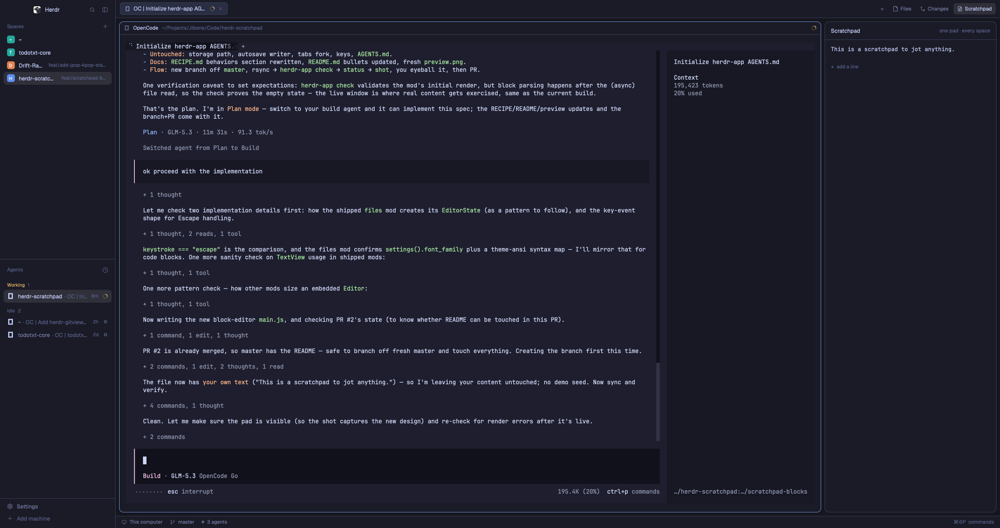

# Scratchpad

A whole-app Scratchpad for the Herdr app: a "Scratchpad" pill in the tab bar
after Files / Changes that opens a notes pane on the right side of the
window. One pad for the whole app — the same text in every space, saved as
you type to one text file, still there after a restart or a hot reload.



## What you see

- Everything in the pad is mono (the terminal font from settings.json,
  falling back to JetBrains Mono) — a notes pane that shares its type with
  the terminals beside it, with no editor chrome anywhere: no line numbers,
  no folding, no gutter.
- The document renders as blocks on the card's theme background (1 px
  border, 10 px corners, a 42 px header with "Scratchpad" and the dim
  right-aligned "one pad · every space"):
  - `# / ## / ###` headings: semibold, 19 / 16.5 / 15 px.
  - `---`: a 1 px theme-border rule.
  - `- [ ]` / `- [x]` todos: a 15 px checkbox (accent-filled with a ✓ when
    done), the label struck through and dimmed when done.
  - ```` ``` ```` fences: a code card on theme surface with syntax coloring
    from the terminal's ANSI palette, 12 px, no line numbers, no folding;
    long lines scroll sideways, they never wrap.
  - plain lines through `TextView.markdown`, so `**bold**`, `` `code` ``
    and links render inline.
  - the pad always ends with a dim "+ add a line" row.

## How it behaves

- Click any block: it becomes a textarea holding its raw text (`# Header`,
  `- [ ] milk`) with the caret at the end. Every keystroke splices into the
  document and saves atomically — the file is current at every moment.
- Commit is blur, click-away, or Escape: the block then re-splits where its
  lines demand it, so Enter inside a heading splits it into blocks, and a
  pasted fence becomes a code card the moment you click away.
- Todos tick with one click on the box (the label's own click starts its
  edit). Ticking saves immediately.
- Code blocks are edited in place — the fences never show; click into the
  code and type. A fence typed without its closer is closed automatically
  on commit, so it can never swallow the pad on reload.
- The last empty line is always editable: the pad's endless new line.
- The pill and `cmd-shift-s` toggle the pane; each space remembers whether
  it had the pad open, exactly like Files and Changes.

## Built from

- `mods/scratchpad/` — the pane. The file's lines parse into block objects
  (`kind`, `from`, `to`, and per-kind fields); blocks are stable objects,
  so click handlers resolve them by `indexOf` at event time, never by a
  stale index. Editing splices `this.lines` per keystroke; commit re-splits
  just that block (`parseLines` over its new lines) and shifts later
  blocks' offsets. A code block owns a live `EditorState.new({
  line_numbers: false, folding: false, soft_wrap: false, font_family,
  font_size: 12, syntax: <theme ANSI colors> })` created at parse or commit
  time — host calls, never in render — and released when replaced. Inline
  editing creates one `TextareaState` (`set_soft_wrap(true)`,
  `set_auto_grow(1, 60)`) per edit. Text lines render through
  `TextView.markdown`, their ids carrying a content hash. Mono is
  `settings().font_family ?? "JetBrains Mono"`. Saving is one serialized
  writer loop over `writeTextFile` (atomic, compare-to-expected, latest
  wins) — unchanged from the first build.
- `mods/tabs-scratchpad/` — unchanged from the first build.
- `layouts/main-copy.json` — the daily layout; the pad block's default
  width is now 400 px.
- `keys.json`: `"layout:main-copy": { "cmd-shift-s": ... }` as before.
- Art: the 24×24 one-color notepad glyph (`icon.svg`), unchanged.

## Watch out

- No cross-block undo: undo works inside the focused editor or textarea;
  a commit or a todo tick is not undoable.
- No arrow-key navigation between blocks — the pad is mouse-first.
- Escape-commit depends on the key bubbling out of the textarea; blur and
  click-away always commit.
- Typing a ``` line inside a code block's content would close the block on
  the next reload (the live view stays as it was) — don't.
- Clicking a link inside a text line may open it and start that line's
  edit at once.
- `herdr-app check` validates the loading render; blocks appear after the
  async file read, so the live window is where content is exercised.
- Two windows editing at once: atomic compare-to-expected writes, latest
  writer wins.
- `readTextFile` caps at 1 MiB: the pad is not a place for megabyte notes.

## Done when

- `herdr-app check` passes and `herdr-app status` shows no errors with the
  pad open.
- Typing in a block saves per keystroke (the file on disk matches), and the
  pad survives a restart and a hot reload.
- `# ` renders as a heading, `---` as a rule, `- [ ]` as a tickable todo,
  and a pasted fence as a code card — each from the commit that created it.
- A fence typed without its closer closes itself; nothing below it is
  swallowed after a reload.
- The same text shows from a different space; each space restores its own
  open/closed state.
- `cmd-shift-s` and the pill still toggle the pane.
